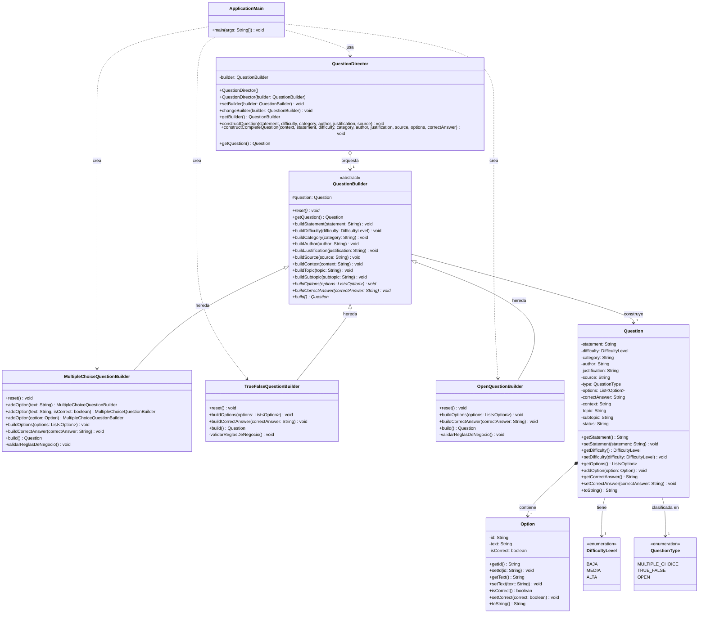

# Informe de Laboratorio - Taller 7: Patrones de Diseño Creacionales (Builder)

**Asignatura:** Laboratorio de Ingeniería del Software II  
**Período Académico:** 2026.2  
**Docentes:** Wilson Libardo Pantoja Y., Julio Ariel Hurtado, Pablo Magé  
**Universidad del Cauca** - Facultad de Ingeniería Electrónica y Telecomunicaciones  
**Programa:** Ingeniería de Sistemas  

---

## 1. Breve Resumen del Proyecto de Clase

El proyecto de curso consiste en el **Sistema para la Gestión, Validación y Administración de un Banco de Preguntas para la Preparación de las Pruebas Saber Pro**. Su objetivo es apoyar a docentes y estudiantes del programa de Ingeniería de Sistemas mediante la creación colaborativa, validación pedagógica/estructural y administración del ciclo de vida de preguntas de evaluación (diseño centrado en evidencias), así como la generación de simulacros académicos.

En este taller se aborda la construcción desacoplada y progresiva de los distintos tipos de preguntas del banco (`Selección Múltiple`, `Verdadero / Falso` y `Pregunta Abierta`), aplicando el patrón de diseño creacional **Builder** de GoF y asegurando el cumplimiento de las reglas de negocio estructurales (definidas en el requerimiento HU03 del proyecto).

---

## 2. Aplicación del Patrón Creacional Builder

### Justificación y Beneficios
El patrón **Builder** separa la lógica de construcción de un objeto complejo de su representación particular, permitiendo que un mismo proceso de construcción cree diferentes representaciones o tipos de productos. En el banco de preguntas:
- **Director (`QuestionDirector`):** Define el flujo u orden canónico de construcción (contexto, enunciado, dificultad, categoría, autor, justificación, fuente, opciones, clave) sin conocer la lógica interna ni las reglas particulares de cada tipo de pregunta.
- **Builder Abstracto (`QuestionBuilder`):** Proporciona la interfaz y operaciones estándar para construir partes de una pregunta (`reset()`, `buildStatement()`, `buildDifficulty()`, etc.).
- **Builders Concretos (`MultipleChoiceQuestionBuilder`, `TrueFalseQuestionBuilder`, `OpenQuestionBuilder`):** Ensamblan el producto según su naturaleza y aplican validaciones estrictas antes de devolver la instancia final en `build()`.
- **Producto (`Question`):** Entidad enriquecida con opciones, justificación pedagógica, nivel de dificultad y metadatos Saber Pro.

---

## 3. Reglas de Negocio Implementadas

1. **Validación de Campos Obligatorios:**
   - Toda pregunta debe tener un enunciado no nulo y no vacío.
2. **Validación Específica por Tipo:**
   - **Selección Múltiple:** Requiere al menos dos opciones de respuesta (típicamente 4 opciones según las especificaciones Saber Pro).
   - **Verdadero / Falso:** Configura automáticamente las dos opciones estándar ("Verdadero" y "Falso").
   - **Pregunta Abierta:** Garantiza que no posea opciones de respuesta cerrada fijas.
3. **Validación de Respuestas Válidas:**
   - En selección múltiple, la respuesta correcta debe existir obligatoriamente dentro del listado de opciones configuradas.
   - Debe existir exactamente una respuesta correcta (RF-11).
   - En verdadero/falso, la clave debe ser exclusivamente `"Verdadero"` o `"Falso"`.
4. **Reglas de Calidad Saber Pro (RF-12):**
   - Se prohíbe el uso de opciones con expresiones como *"Todas las anteriores"* o *"Ninguna de las anteriores"*.

---

## 4. Diagrama UML de Clases

A continuación se presenta el diagrama UML en sintaxis PlantUML y Mermaid, representando la arquitectura desarrollada acorde a la Figura 3 de la guía:



---

## 5. Pruebas Unitarias Automatizadas (JUnit 5)

Se desarrollaron pruebas unitarias automatizadas para cada Builder, cubriendo al 100% los requisitos de evaluación estipulados en la guía:

| Clase de Prueba | Pruebas Implementadas | Criterio Evaluado | Resultado |
|---|---|---|---|
| `MultipleChoiceQuestionBuilderTest` | 9 pruebas | Construcción válida, validación de enunciado vacío/nulo, validación de opciones (mínimo 2), respuesta correcta inexistente, RF-12 expresiones prohibidas ("Todas las anteriores", "Ninguna de las anteriores"), orquestación con Director | **100% Exitoso** |
| `TrueFalseQuestionBuilderTest` | 6 pruebas | Construcción con clave "Verdadero", construcción con clave "Falso", validación sin enunciado, validación sin clave, validación con respuesta inválida, orquestación con Director | **100% Exitoso** |
| `OpenQuestionBuilderTest` | 4 pruebas | Construcción de pregunta abierta con rúbrica, validación sin enunciado, verificación de lista de opciones vacía, **demostración de construcción polimórfica de diferentes productos mediante el mismo Director** | **100% Exitoso** |

**Total de Pruebas Ejecutadas:** 19 pruebas  
**Fallos / Errores:** 0  

---

## 6. Instrucciones de Compilación y Ejecución

El proyecto cuenta con configuración de construcción Maven (`pom.xml`) y JDK 17+:

1. **Ejecutar Pruebas Unitarias:**
   ```bash
   mvn clean test
   ```
2. **Ejecutar Demostración Principal (Cliente Main):**
   ```bash
   mvn compile exec:java
   ```
   O directamente:
   ```bash
   java -cp target/classes ApplicationMain
   ```

---

## 7. Enlace al Repositorio de GitHub

- **Repositorio del Grupo:** *(Inserte aquí la URL del repositorio remoto una vez subido a GitHub)*
